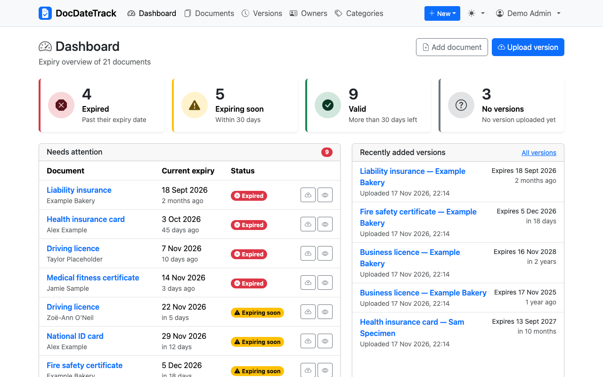

# DocDateTrack

[](https://github.com/serbantasss/DocDateTrack/actions/workflows/ci.yml)
[](https://github.com/serbantasss/DocDateTrack/actions/workflows/docker.yml)
[](LICENSE)

**Never miss an expiry date again.** DocDateTrack is a self-hosted web app that keeps track of when your important documents expire — passports, ID cards, driving licences, contracts, certificates, permits, insurance policies — and reminds you before they lapse. It is made for households and small organisations, and your documents stay on your own server.



## Features

- **See what needs attention at a glance** — the dashboard counts expired, expiring and valid documents and lists the most urgent ones first.
- **Every document, every renewal** — organise documents by owner (people or organisations) and category, and keep each renewal as a version with its issue and expiry dates, notes and a scan.
- **Statuses computed for you** — Expired, Expiring soon (within 30 days, or a period you choose), Valid or No versions, always up to date.
- **Find things quickly** — filter by owner, category, scope and status, and search names regardless of case and accents.
- **Email reminders** — a digest for administrators and, optionally, reminders for the owners themselves: about each document once when it starts expiring and once when it has expired.
- **Scans in safe hands** — PDF, JPEG, PNG and WebP files are checked by their content, stored under random names and only available to signed-in users.
- **Accounts for your household or team** — administrators and members, registration closed by default, and user management in the browser.
- **Secure by default** — CSRF protection, a strict Content Security Policy, rate-limited sign-in, hashed passwords, and no third-party assets or tracking.
- **Easy to run** — a Docker image for amd64 and arm64 and a Compose file that includes MongoDB; light and dark mode included.

## Quick start (Docker Compose)

You need Docker with Docker Compose v2. In an empty directory, download the Compose file, create a `.env` file with a random session secret, and start DocDateTrack:

```bash
mkdir docdatetrack && cd docdatetrack
curl -fsSLO https://raw.githubusercontent.com/serbantasss/DocDateTrack/main/compose.yaml
printf 'SESSION_SECRET=%s\n' "$(openssl rand -hex 32)" > .env
docker compose up -d
```

Open <http://localhost:8080> and **create your account right away**: the first account becomes the administrator. After that, registration is closed, and administrators add accounts under **Users**.

Before you rely on it, follow the **[deployment guide](docs/deployment.md)**: it covers your time zone (`TZ`), HTTPS with a reverse proxy, email reminders, backups, upgrades and running without Docker. [`.env.example`](.env.example) lists every setting.

## Try it with demo data

To look around first, start a separate demo instance with fictional owners, documents and sample scans:

```bash
mkdir docdatetrack-demo && cd docdatetrack-demo
curl -fsSLO https://raw.githubusercontent.com/serbantasss/DocDateTrack/main/compose.yaml
printf 'SESSION_SECRET=%s\nMONGODB_DATABASE=docdatetrack_demo\n' "$(openssl rand -hex 32)" > .env
docker compose up -d
docker compose exec app npm run db:seed
```

Open <http://localhost:8080> and sign in as `demo` (administrator) or `demo.member` (member) with the password `LocalDemoOnly123!`. When you are done, `docker compose down -v` deletes the demo with all its data. The seeder only writes to databases whose name ends in `_dev` or `_demo` — never load demo data into a real instance. If a real instance runs on the same machine, give the demo other ports first; see [Trying DocDateTrack with demo data](docs/deployment.md#trying-docdatetrack-with-demo-data).

## Local development

You need Node.js 24 (see `.nvmrc`) and Docker for MongoDB:

```bash
git clone https://github.com/serbantasss/DocDateTrack.git && cd DocDateTrack
nvm install && nvm use
npm ci
cp .env.example .env        # then set SESSION_SECRET to the output of: openssl rand -hex 32
docker compose up -d mongo  # MongoDB on 127.0.0.1:27018
npm run db:seed             # optional demo data
npm run dev                 # http://localhost:8080, restarts when you change a file
```

Before you open a pull request, run `npm run lint`, `npm run format:check` and `npm test`. The **[development guide](docs/development.md)** explains the architecture, the tests and the conventions, and the [contributing guide](CONTRIBUTING.md) explains how to contribute.

## Configuration

DocDateTrack is configured with environment variables — with Docker Compose, in the `.env` file next to `compose.yaml`. The most important ones:

| Variable                                 | Default                 | Purpose                                                                                        |
| ---------------------------------------- | ----------------------- | ---------------------------------------------------------------------------------------------- |
| `SESSION_SECRET`                         | (required)              | Signs the session cookies. Generate it with `openssl rand -hex 32`.                            |
| `APP_URL`                                | `http://localhost:8080` | The address people use to open DocDateTrack, for links in emails.                              |
| `TZ`                                     | `UTC` in Docker         | Your time zone, such as `Europe/Berlin`: it decides what "today" is and when reminders go out. |
| `TRUST_PROXY`, `COOKIE_SECURE`           | `false`, `auto`         | Behind an HTTPS reverse proxy, set them to `1` and `true`.                                     |
| `ALLOW_REGISTRATION`                     | `false`                 | `true` lets anyone who can reach DocDateTrack create a member account.                         |
| `EXPIRY_WARNING_DAYS`                    | `30`                    | How many days before the expiry date a document counts as "expiring soon".                     |
| `MAX_UPLOAD_MB`                          | `10`                    | Maximum size of an uploaded file.                                                              |
| `REMINDERS_ENABLED`, `REMINDER_CRON`     | `false`, `0 8 * * *`    | Scheduled email reminders, by default every day at 08:00.                                      |
| `SMTP_HOST` … or `SMTP_URL`, `MAIL_FROM` | —                       | The SMTP server that sends the reminders.                                                      |
| `DOCDATETRACK_VERSION`                   | `latest`                | The image version that Docker Compose runs.                                                    |

The **[configuration reference](docs/configuration.md)** describes every setting, with accepted values and notes on reverse proxies, time zones and cron schedules.

## Forgot the administrator password?

Anyone with shell access to the server can reset a password from the command line. The new, random password is printed once, and the user is signed out everywhere:

```bash
docker compose exec app npm run users -- reset-password <username or email>
```

The same command can also `list` the accounts, `create-admin <username> <email>`, and `promote <username or email>` an existing user to administrator; see `npm run users -- --help` and [Locked out?](docs/user-guide.md#locked-out) in the user guide.

## Documentation

- [User guide](docs/user-guide.md) — concepts, first steps, documents and versions, reminders, users and roles.
- [Deployment guide](docs/deployment.md) — Docker Compose, HTTPS, email reminders, backups, maintenance and troubleshooting.
- [Configuration reference](docs/configuration.md) — every setting.
- [Upgrading](docs/upgrading.md) — new releases, rollbacks and the 2023 prototype.
- [Development guide](docs/development.md) — architecture, testing and conventions.
- [Contributing](CONTRIBUTING.md), [Security policy](SECURITY.md), [Changelog](CHANGELOG.md) and [Code of Conduct](CODE_OF_CONDUCT.md).

## Upgrading from the 2023 prototype

DocDateTrack 1.0 replaces the unreleased 2023 prototype. Its migration script, `npm run db:migrate`, moves the login accounts from the owners to separate user accounts (passwords keep working), turns the category relations `DP`, `DF` and `DPF` into scopes and converts the versions. Preview it with `npm run db:migrate -- --dry-run`, run it before anyone else can reach the new installation, and expect everyone to sign in again. See [Upgrading from the 2023 prototype](docs/upgrading.md#upgrading-from-the-2023-prototype).

## Security

DocDateTrack protects every form against CSRF, sends a strict Content Security Policy and other security headers, rate-limits failed sign-in attempts, hashes passwords with PBKDF2, checks uploads by their content and serves files only to signed-in users. Before you go live, work through the [deployment hardening checklist](SECURITY.md#deployment-hardening). Please report vulnerabilities privately, as described in the [security policy](SECURITY.md) — never in a public issue.

## Contributing

Contributions of all kinds are welcome: bug reports, feature ideas, documentation improvements and code. Please read the [contributing guide](CONTRIBUTING.md) and follow the [Code of Conduct](CODE_OF_CONDUCT.md). Use made-up data only, never real documents, in issues, screenshots and tests.

## Licence

DocDateTrack is free software, released under the [MIT Licence](LICENSE).

## Acknowledgements

- [Bootstrap](https://getbootstrap.com/) and [Bootstrap Icons](https://icons.getbootstrap.com/), both MIT-licensed, which DocDateTrack serves itself instead of loading them from a CDN.
- The colour mode switcher, [`public/js/color-modes.js`](public/js/color-modes.js), is adapted from the colour mode toggler in the Bootstrap documentation, © The Bootstrap Authors, licensed under [CC BY 3.0](https://creativecommons.org/licenses/by/3.0/); its attribution header is kept in the file.
- DocDateTrack is built on [Node.js](https://nodejs.org/), [Express](https://expressjs.com/), [MongoDB](https://www.mongodb.com/) with [Mongoose](https://mongoosejs.com/), [Passport](https://www.passportjs.org/), [Pug](https://pugjs.org/), [Luxon](https://moment.github.io/luxon/), [Nodemailer](https://nodemailer.com/) and the other open-source packages listed in [`package.json`](package.json).
