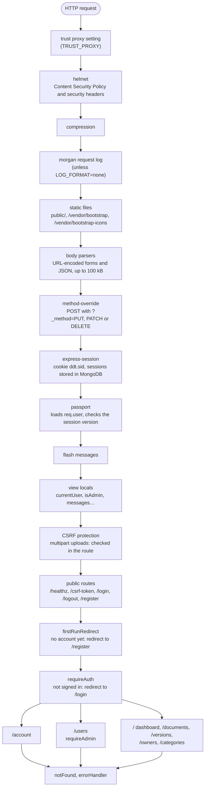
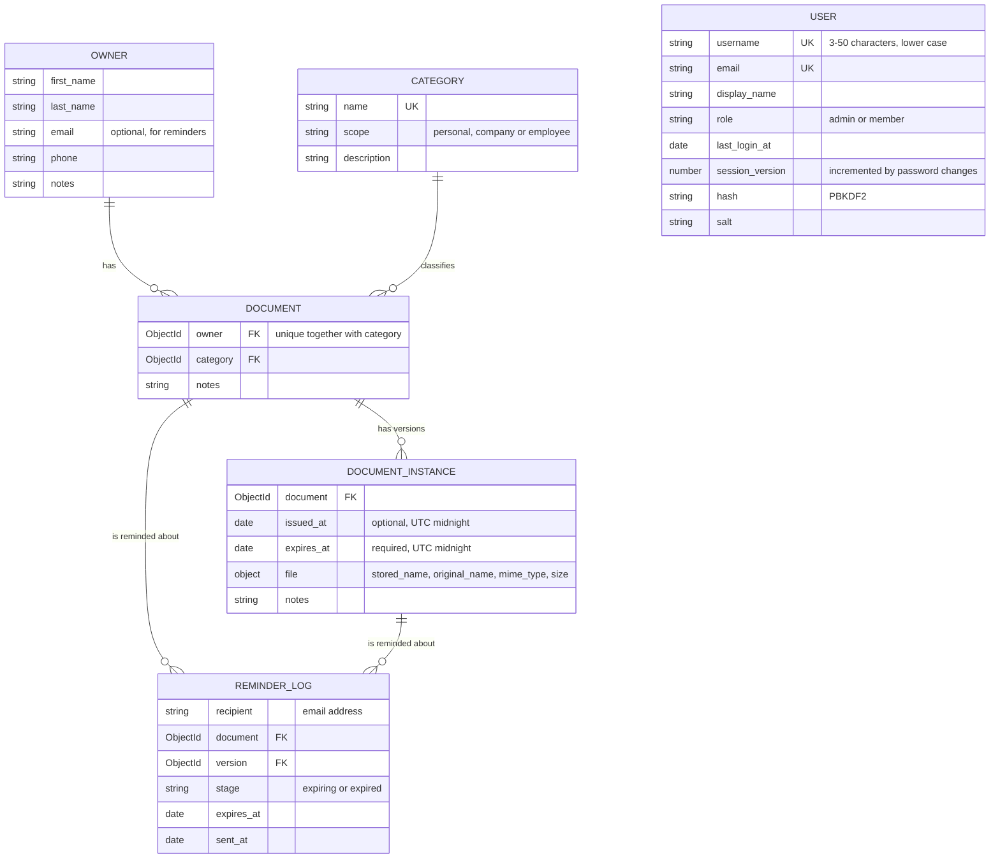

# Development guide

This guide is for people who want to change DocDateTrack: how it is built, how the main parts work, how to test it and which conventions to follow. Start with the [contributing guide](../CONTRIBUTING.md) for how to report issues and open pull requests.

## Contents

- [Setting up](#setting-up)
- [Architecture](#architecture)
- [Project layout](#project-layout)
- [How the status is computed](#how-the-status-is-computed)
- [The upload pipeline](#the-upload-pipeline)
- [Email reminders](#email-reminders)
- [Testing](#testing)
- [Conventions](#conventions)
- [Adding a page](#adding-a-page)
- [Demo data](#demo-data)
- [Troubleshooting](#troubleshooting)

## Setting up

You need Git, Node.js 24 (the version in `.nvmrc`; with [nvm](https://github.com/nvm-sh/nvm): `nvm install && nvm use`) and Docker for MongoDB.

```bash
git clone https://github.com/serbantasss/DocDateTrack.git
cd DocDateTrack
nvm install && nvm use      # Node.js version from .nvmrc
npm ci                      # exact dependency versions from package-lock.json
cp .env.example .env        # then set SESSION_SECRET to the output of: openssl rand -hex 32
docker compose up -d mongo  # MongoDB on 127.0.0.1:27018 (MONGODB_PORT)
npm run db:seed             # optional: demo data, see "Demo data" below
npm run dev                 # http://localhost:8080; restarts when a file changes
```

`.env.example` is set up for development: `NODE_ENV=development` (stack traces on error pages, no view cache) and the database `docdatetrack_dev` in the Compose MongoDB. `npm run dev` runs `node --watch`, which restarts the server when a JavaScript file changes; Pug templates and files in `public/` are read on every request in development, so a browser reload is enough.

| Command                         | What it does                                                              |
| ------------------------------- | ------------------------------------------------------------------------- |
| `npm run dev`                   | Starts the server and restarts it when a file changes.                    |
| `npm start`                     | Starts the server without file watching.                                  |
| `npm test`                      | Runs the test suite.                                                      |
| `npm run lint`                  | Runs ESLint; `npm run lint -- --fix` fixes what it can.                   |
| `npm run format:check`          | Checks the formatting with Prettier; `npm run format` fixes it.           |
| `npm run db:seed`               | Loads demo data.                                                          |
| `npm run db:migrate`            | Migrates a database of the 2023 prototype; see [upgrading](upgrading.md). |
| `npm run reminders:send`        | Sends the due email reminders now (`-- --dry-run`, `-- --test <email>`).  |
| `npm run users`                 | Manages accounts from the command line (`-- --help`).                     |
| `npm run uploads:check`         | Compares `UPLOAD_DIR` with the database (`-- --delete-orphans`).          |
| `docker compose stop mongo`     | Stops MongoDB; the data is kept.                                          |
| `docker compose down --volumes` | Removes the containers and **deletes** the local database.                |

Every setting is described in the [configuration reference](configuration.md). Use made-up data only — never real documents — in your development environment.

## Architecture

DocDateTrack is a server-rendered [Express 5](https://expressjs.com/) application. It stores its data in MongoDB through [Mongoose](https://mongoosejs.com/), renders HTML with [Pug](https://pugjs.org/) and [Bootstrap 5.3](https://getbootstrap.com/), and uses only a little browser JavaScript for progressive enhancements.

- `bin/www` loads and validates the configuration (`config/index.js`), connects to MongoDB, creates the app with `createApp({ config })` from `app.js`, starts the HTTP (and optional HTTPS) server and the reminder scheduler, and shuts everything down gracefully on `SIGTERM` or `SIGINT`.
- `app.js` assembles the middleware and routers. The configuration object is available to every handler as `req.app.get('config')`.
- The command-line tasks in `tasks/` reuse the same configuration loader, models and services.

### Request pipeline

Every request passes through the middleware in this order (see `createApp()` in `app.js`):



- **Security headers** — helmet sends a strict Content Security Policy (`default-src 'self'`, no inline scripts or styles, `object-src 'none'`, `frame-ancestors 'none'`, `form-action 'self'`), `X-Frame-Options: DENY` and `Referrer-Policy: same-origin`. HSTS is left to the TLS-terminating proxy, so that plain-HTTP installations on a home network keep working.
- **Sessions** — sessions are stored in the `sessions` collection by [connect-mongo](https://github.com/jdesboeufs/connect-mongo). The cookie is `HttpOnly` and `SameSite=Lax`, and `Secure` according to `COOKIE_SECURE`. Each session stores the user id and the user's `session_version`, which every password change increments: sessions with an older version are signed out.
- **CSRF** — `middleware/csrf.js` keeps a random token per session. Every state-changing request must send it as the `_csrf` form field or the `X-CSRF-Token` header; the token is available to views as `csrfToken`, and to scripts from `GET /csrf-token`. Multipart forms are parsed by the upload route, so their token is checked there with `verifyCsrf`, right after multer — but only for same-origin `POST` and `PUT` requests; any other multipart request must send the header.
- **Authentication** — [Passport](https://www.passportjs.org/) with the local strategy of [passport-local-mongoose](https://github.com/saintedlama/passport-local-mongoose); passwords are hashed with PBKDF2. Sign-in, registration and password changes are rate limited per client IP (`middleware/rateLimit.js`); accounts are never locked.
- **Errors** — `middleware/errors.js` renders `views/error.pug` (or JSON for clients that prefer it): unknown or malformed ids give 404, a missing or wrong CSRF token 403, errors created with [http-errors](https://github.com/jshttp/http-errors) keep their status, and anything else is logged and answered with 500. Stack traces are only shown when `NODE_ENV=development`.

### Data model



| Model (`models/`)                          | Collection          | Notes                                                                                              |
| ------------------------------------------ | ------------------- | -------------------------------------------------------------------------------------------------- |
| `User` (`user.js`)                         | `users`             | Sign-in accounts; `User.ROLES` maps `admin` and `member` to their labels. Not related to owners.   |
| `Owner` (`owner.js`)                       | `owners`            | Virtuals `name` ("First Last") and `url`.                                                          |
| `Category` (`category.js`)                 | `categories`        | `Category.SCOPES` maps `personal`, `company` and `employee` to their labels.                       |
| `Document` (`document.js`)                 | `documents`         | One per owner and category (unique index). Virtuals `url` and `title` ("Passport — Alex Example"). |
| `DocumentInstance` (`documentInstance.js`) | `documentinstances` | A **version**, as it is called in the interface and URLs. Virtuals `url` and `download_url`.       |
| `ReminderLog` (`reminderLog.js`)           | `reminderlogs`      | One entry per reminder sent; see [Email reminders](#email-reminders).                              |

All models have `createdAt` and `updatedAt` timestamps. The status of a document is never stored; the sign-in sessions live in the `sessions` collection.

## Project layout

```text
app.js                     createApp(): middleware, routers, error handling
bin/www                    entry point: configuration, MongoDB, HTTP(S) servers, scheduler, shutdown
config/
  index.js                 loadConfig(): reads and validates the environment variables
  passport.js              local strategy and session (de)serialisation
controllers/               request handlers, one module per area
  userForms.js             validation rules shared by registration, account and user forms
lib/format.js              view helpers available as `fmt`: dates, relative days, file sizes
middleware/                auth.js, csrf.js, errors.js, flash.js, locals.js, rateLimit.js
models/                    Mongoose models (see above)
public/                    static files
  js/                      app.js (confirmations, auto-submit, tooltips), color-modes.js, uploads.js
  stylesheets/app.css      the only custom stylesheet
routes/                    Express routers; index.js mounts the dashboard, documents, versions,
                           owners and categories routers
services/
  cascade.js               deletes versions and documents together with their files
  documents.js             findDocumentsWithStatus(), sortByUrgency(), summarize()
  mailer.js                SMTP transport (nodemailer)
  pagination.js            page numbers and links for long lists
  records.js               lookups and validation helpers shared by documents and versions
  reminders.js             plans, composes and sends the reminder emails
  scheduler.js             runs the reminders on REMINDER_CRON (node-cron)
  status.js                calendar-date helpers and the status computation
  storage.js               safe paths of stored files
  uploads.js               upload parsing and file type detection
tasks/                     command-line tasks: seed-demo-data.js, migrate-legacy-data.js,
                           send-reminders.js, manage-users.js, check-uploads.js
test/                      tests (<area>.<topic>.test.js); helpers in test/helpers/
views/
  layout.pug               layout of signed-in pages (navigation bar, flash messages, footer)
  layouts/auth.pug         layout of the sign-in and registration pages
  partials/                head, navigation bar, flash messages, footer, scripts
  mixins/                  forms.pug, ui.pug, layout.pug, documents.pug
  dashboard.pug, documents/, versions/, owners/, categories/, account/, users/, auth/
  emails/                  HTML templates of the reminder and test emails
  error.pug                error page
docs/                      documentation; screenshots in docs/images/
```

## How the status is computed

The status logic lives in `services/status.js` and `services/documents.js`; it is never stored in the database.

- **Calendar dates** — `issued_at` and `expires_at` are calendar dates without a time of day. They are stored as **midnight UTC** of that date: `toDateOnlyUtc('2026-12-07')` returns `2026-12-07T00:00:00.000Z`. Forms submit `YYYY-MM-DD`, which is parsed as UTC, and views format these dates in the `utc` zone (`fmt.date()`, `fmt.dateInput()`), so they never shift by a day, whatever the server's time zone.
- **Today** — `todayUtc(now)` takes the **server's local calendar date** (in the time zone `TZ`) and returns it as midnight UTC, so that it can be compared with the stored dates. On a server in Berlin, 17 November at 00:30 local time is still 16 November in UTC, but `todayUtc()` returns 17 November.
- **Days left** — `daysUntil(expiresAt, now)` returns whole days: `0` when the document expires today, a negative number once it has expired, `null` without a date.
- **Status** — `computeStatus(expiresAt, { now, warningDays })` returns `missing` without a date, `expired` when the days left are below 0, `expiring` when they are at most `warningDays` (`EXPIRY_WARNING_DAYS`), and `valid` otherwise.
- **Current version** — `findDocumentsWithStatus({ match, now, warningDays })` loads the documents (with owner and category) and, in one aggregation, the version with the latest `expires_at` of each (ties: the latest `_id`) and the number of versions. Each row is `{ document, currentVersion, versionCount, status, daysUntil }`.
- **Order and counts** — `sortByUrgency(rows)` sorts by status (expired, expiring, missing, valid), then by days left, then by title; `summarize(rows)` counts the rows per status.

```js
const { computeStatus, daysUntil, toDateOnlyUtc } = require('./services/status');

const expiresAt = toDateOnlyUtc('2026-12-07');
const now = new Date(2026, 10, 17, 23, 30); // 17 November 2026, 23:30 server time

daysUntil(expiresAt, now); // 20
computeStatus(expiresAt, { now, warningDays: 30 }); // 'expiring'
computeStatus(expiresAt, { now, warningDays: 14 }); // 'valid'
```

The dashboard, the lists, the reminders and the tests all use these functions. Functions that depend on the date accept `now`, so tests never depend on the real clock.

## The upload pipeline

Version forms are `multipart/form-data` forms with one optional `file` field. The route chain in `routes/versions.js` is:

```js
router.post('/', uploadSingle('file'), verifyCsrf, versions.create);
router.put('/:id', uploadSingle('file'), verifyCsrf, versions.update);
```

1. **Parsing** — `uploadSingle('file')` (`services/uploads.js`) lets [multer](https://github.com/expressjs/multer) write the file to `UPLOAD_DIR` under a random UUID, with limits for the file size (`MAX_UPLOAD_MB`), the number of files (one), fields and parts.
2. **Type detection** — the first bytes of the file decide its type: `%PDF-` for PDF, `FF D8 FF` for JPEG, the PNG signature, or `RIFF…WEBP` for WebP. The name and the MIME type sent by the browser are ignored. Accepted files are renamed to `<uuid>.<ext>`; rejected ones (wrong type, empty, too large) are deleted at once and reported as an error of the file field.
3. **CSRF** — `verifyCsrf` checks the `_csrf` field now that the body is parsed. That is why `_csrf` is the first field of the form and the file the last one: the other fields are parsed even when the file is rejected.
4. **Validation** — express-validator rules check the dates and notes; the `uploadedFile('file')` rule turns a rejected upload into a field error, so the form is shown again with status 422.
5. **Saving** — the handler saves the version inside `req.upload.commit(() => version.save())`. `req.upload` is an `UploadTracker`: once the response is finished, it deletes every stored file that was not committed — after validation errors, CSRF failures, exceptions or aborted requests — so no orphaned files are left behind.
6. **Metadata** — the version stores `file: { stored_name, original_name, mime_type, size }`. `original_name` is the browser's file name without path, control characters, bidirectional marks and leading or trailing dots, at most 255 characters. Its extension always matches the detected type: a PDF uploaded as `invoice.html` is called `invoice.html.pdf`, so a downloaded file can never be opened as a web page or a script. The name is only used for display and downloads, never as a path.

Replacing or removing the file of a version deletes the old file after the version has been saved. Saving an edited version uses optimistic concurrency (`version.increment()`): if someone else saved the same version since the form was loaded, the save fails and the form is shown again with status 409 and "This version was changed by someone else; reload and try again.", so two edits can never both replace the same file. Deleting versions, documents or owners goes through `services/cascade.js`, which deletes the database records first and the files afterwards, so a failure can at worst leave an orphaned file, never a version without its file.

**Downloads** (`GET /versions/:id/download`) only serve the file recorded for an existing version: `services/storage.js` refuses anything but a bare file name inside `UPLOAD_DIR`. The response is always an attachment with the file's display name, `Cache-Control: private, no-store` and `X-Content-Type-Options: nosniff`. Its `Content-Type` is the detected type; files of other types, such as those linked by the migration from the 2023 prototype, are sent as `application/octet-stream`.

`public/js/uploads.js` also checks the size in the browser, before the form is sent; the server checks it again.

### Checking the upload directory

`npm run uploads:check` (`tasks/check-uploads.js`) compares `UPLOAD_DIR` with the versions in the database and reports files that no version uses and versions whose file is missing; hidden files are ignored. With `-- --delete-orphans`, it deletes unused files that DocDateTrack created (named `<uuid>.<ext>`) and that are older than one hour; other files are only reported. It exits with `0` when it found no problems, `1` when unused or missing files remain, and `2` when the check itself failed.

## Email reminders

| Module                    | Responsibility                                                                                                           |
| ------------------------- | ------------------------------------------------------------------------------------------------------------------------ |
| `services/reminders.js`   | `planReminders()` decides who gets which reminders (pure function); `sendReminders()` loads the data, sends and records. |
| `services/mailer.js`      | Creates the nodemailer transport from the SMTP settings; `send()` and `verify()`.                                        |
| `services/scheduler.js`   | Schedules `sendReminders()` on `REMINDER_CRON` in the server's time zone; runs never overlap.                            |
| `models/reminderLog.js`   | One entry per reminder sent: recipient, document, version, stage and expiry date.                                        |
| `views/emails/`           | HTML templates; `services/reminders.js` builds the plain-text part.                                                      |
| `tasks/send-reminders.js` | The `npm run reminders:send` command (`--dry-run`, `--test <email>`).                                                    |

How a run works:

1. `findDocumentsWithStatus()` finds the documents that are expired or expiring soon and have a current version.
2. Every administrator gets all of them; with `NOTIFY_OWNERS=true`, owner email addresses get their own documents. Each address gets one email.
3. A reminder is identified by recipient, version, stage (`expiring` or `expired`) and expiry date. Reminders that are already in the reminder log are left out of the email; a new version or a changed expiry date has a new identity, so its reminders start over.
4. A reminder is recorded only after its email was sent, so failed emails are retried on the next run. A unique index on the reminder log prevents duplicate entries.

The reminder emails are HTML with a plain-text alternative. Email clients ignore external CSS, so the templates in `views/emails/` use inline styles — the Content Security Policy rules for web pages do not apply to them, but all output must still be escaped.

To try reminders locally without sending anything, run `npm run reminders:send -- --dry-run`: it prints each planned email. To see real emails, point `SMTP_HOST` and `SMTP_PORT` at a local mail catcher such as [Mailpit](https://mailpit.axllent.org/) and run `npm run reminders:send`.

## Testing

```bash
npm test                                          # all tests
node --test test/domain.documents.test.js         # one file
node --test --test-name-pattern="documents list" test/domain.documents.test.js   # matching tests
```

- Tests use the built-in [`node:test`](https://nodejs.org/api/test.html) runner and [supertest](https://github.com/ladjs/supertest). Files are named `test/<area>.<topic>.test.js`, for example `domain.uploads.test.js` or `reminders.planning.test.js`.
- By default, every test file starts its own in-memory MongoDB server with [mongodb-memory-server](https://github.com/typegoose/mongodb-memory-server); the first run downloads a MongoDB binary. To use an existing server instead, set `MONGODB_TEST_URI`, for example `MONGODB_TEST_URI=mongodb://127.0.0.1:27018 npm test`. Each test process then creates its own database there and drops it at the end — never use a server that holds real data.
- Tests must be deterministic and work offline: pass `now` wherever dates matter, and use temporary directories for uploads (`test/helpers/tmp.js`; the test app gets a fresh `UPLOAD_DIR` automatically).

### Test helpers

| Helper                                                                  | Purpose                                                                                                                                                                                             |
| ----------------------------------------------------------------------- | --------------------------------------------------------------------------------------------------------------------------------------------------------------------------------------------------- |
| `startTestDb()`, `clearTestDb()`, `stopTestDb()` (`test/helpers/db.js`) | Connect Mongoose to a test database, empty it between tests, and shut it down.                                                                                                                      |
| `createTestApp(env, options)` (`test/helpers/app.js`)                   | An app with a test configuration (`env` overrides variables, e.g. `{ ALLOW_REGISTRATION: 'true' }`), in-memory sessions, rate limiting off and a temporary `UPLOAD_DIR`. Returns `{ app, config }`. |
| `createUser({ username, email, password, role })`                       | Creates an account (default role `member`, password `TEST_PASSWORD`).                                                                                                                               |
| `loginAgent(app, { username, password })`                               | Returns a signed-in supertest agent.                                                                                                                                                                |
| `getCsrfToken(agent)`                                                   | Returns the CSRF token of the agent's session.                                                                                                                                                      |
| `makeTempDir(prefix)`, `removeTempDir(dir)` (`test/helpers/tmp.js`)     | Temporary directories, removed when the process exits.                                                                                                                                              |

A typical test file:

```js
const assert = require('node:assert/strict');
const { after, before, beforeEach, describe, it } = require('node:test');

const Category = require('../models/category');
const DocumentInstance = require('../models/documentInstance');
const Owner = require('../models/owner');
const { createTestApp, createUser, getCsrfToken, loginAgent } = require('./helpers/app');
const { clearTestDb, startTestDb, stopTestDb } = require('./helpers/db');

before(startTestDb);
after(stopTestDb);
beforeEach(clearTestDb);

describe('owners', () => {
  it('adds an owner', async () => {
    await createUser({ username: 'member' });
    const { app } = createTestApp();
    const agent = await loginAgent(app, { username: 'member' });

    const response = await agent
      .post('/owners')
      .type('form')
      .send({ first_name: 'Alex', last_name: 'Example', _csrf: await getCsrfToken(agent) })
      .expect(302);

    const owner = await Owner.findOne({ last_name: 'Example' });
    assert.equal(response.headers.location, owner.url);
  });
});

describe('versions', () => {
  it('uploads a version with a file', async () => {
    await createUser({ username: 'member' });
    const { app } = createTestApp({ MAX_UPLOAD_MB: '1' });
    const agent = await loginAgent(app, { username: 'member' });
    const owner = await Owner.create({ first_name: 'Alex', last_name: 'Example' });
    const category = await Category.create({ name: 'Passport', scope: 'personal' });

    await agent
      .post('/versions')
      // Multipart requests must look same-origin, as they do in a browser.
      .set('Sec-Fetch-Site', 'same-origin')
      .field('_csrf', await getCsrfToken(agent))
      .field('owner', String(owner._id))
      .field('category', String(category._id))
      .field('expires_at', '2030-01-31')
      .attach('file', Buffer.from('%PDF-1.4\n'), {
        filename: 'scan.pdf',
        contentType: 'application/pdf',
      })
      .expect(302);

    const version = await DocumentInstance.findOne();
    assert.equal(version.file.original_name, 'scan.pdf');
  });
});
```

## Conventions

- **JavaScript** — CommonJS modules (`require`, `module.exports`) for Node.js 24. Prefer built-in Node.js features to new dependencies.
- **Express 5** — route handlers may be `async`: when they throw or reject, Express passes the error on to the error handler. Do not wrap them in helpers such as `express-async-handler`, and use [http-errors](https://github.com/jshttp/http-errors) (`createError(404, '…')`) for expected errors. `req.query` is read-only; `res.redirect('back')` no longer exists.
- **Configuration** — read settings from `req.app.get('config')` (or the object passed to a service), never from `process.env`. A new setting belongs in `config/index.js`, `.env.example`, `compose.yaml` if the container needs it, and [the configuration reference](configuration.md).
- **Request input** — form and query values can be strings, arrays or objects. Check the type before using a value (`typeof value === 'string'`, `mongoose.isObjectIdOrHexString(id)`), escape user text before building a regular expression, and never pass request objects into queries.
- **Forms** — validate with [express-validator](https://express-validator.github.io/). On errors, render the form again with status 422, passing `values` (the submitted input) and `errors` (`validationResult(req).mapped()`). After a successful change, add a flash message (`req.flash('success', '…')`) and redirect (Post/Redirect/Get). Unknown or malformed ids answer 404.
- **Views** — every page `extends` a layout, sets `title` and starts with `+pageHeader` (with breadcrumbs on sub-pages). The mixins in `views/mixins/` are available on every page: `forms.pug` (`+form`, which adds the CSRF field and the method override, `+input`, `+select`, `+textarea`, `+checkbox`, `+radios`, `+file`, `+errorSummary`, `+submit`, `+deleteButton`), `ui.pug` (`+icon`, `+pageHeader`, `+statusBadge`, `+scopeBadge`, `+emptyState`, `+alert`, `+linkButton`) and `layout.pug` (navigation). `documents.pug` (`+documentsTable`, `+pagination`, `+versionFile`, `+expiry`) must be included where it is used. The comment at the top of each mixin file documents the options. Never declare page variables named like a layout or mixin local (`title`, `values`, `errors`, `currentUser`, `currentPath`, `fmt`…).
- **Content Security Policy** — views must not contain inline `<script>` blocks, `on*=` event-handler attributes, `style=` attributes, or assets from other sites. Put browser behaviour in a file in `public/js/`, driven by `data-*` attributes (as `data-confirm` and `data-autosubmit` in `public/js/app.js`), load it with `script(src=…)` in `block scripts`, and put styles in `public/stylesheets/app.css`. Front-end libraries are npm dependencies served by the app, like Bootstrap under `/vendor/bootstrap`.
- **Escaping** — output user data with Pug's escaping syntax (`=` and `#{}`), never with `!=` or `!{}`.
- **Dates** — calendar dates are stored as midnight UTC; use the helpers in `services/status.js` and `fmt` (`lib/format.js`) instead of formatting them yourself. See [How the status is computed](#how-the-status-is-computed).
- **Deleting** — delete versions and documents with `deleteVersions()` and `deleteDocuments()` from `services/cascade.js`, so that their files and reminder log entries go too.
- **Style** — Prettier (`.prettierrc`: single quotes, 100 characters per line) and ESLint (`eslint.config.js`) decide formatting questions; Pug templates are not formatted by Prettier, so follow the style of the existing ones (2-space indentation). Comment where the code needs clarification, and leave no dead code behind.

## Adding a page

As an example, this adds a page at `/report` that lists every document, the most urgent first.

1. **Controller** — `controllers/reportController.js`:

   ```js
   const { findDocumentsWithStatus, sortByUrgency } = require('../services/documents');

   async function show(req, res) {
     const { expiryWarningDays: warningDays } = req.app.get('config');
     const rows = sortByUrgency(await findDocumentsWithStatus({ warningDays }));
     res.render('report/index', { title: 'Report', rows });
   }

   module.exports = { show };
   ```

2. **Router** — `routes/report.js`:

   ```js
   const express = require('express');
   const report = require('../controllers/reportController');

   const router = express.Router();

   router.get('/', report.show);

   module.exports = router;
   ```

   Mount it in `routes/index.js` with `router.use('/report', reportRouter);`. Everything mounted there requires signing in; for a page only administrators may see, add `requireAdmin` from `middleware/auth.js` to the route.

3. **View** — `views/report/index.pug`:

   ```pug
   //-
     Expiry report. Locals: title, rows (findDocumentsWithStatus() rows, most urgent first).
   extends ../layout
   include ../mixins/documents

   block content
     +pageHeader({ title: 'Report', icon: 'clipboard-data', subtitle: 'Every document, most urgent first.' })
       +linkButton('/documents', 'All documents', { icon: 'files' })

     if rows.length
       .card.shadow-sm
         +documentsTable(rows, { caption: 'Documents by urgency' })
     else
       +emptyState({ icon: 'inbox', title: 'Nothing to report', message: 'Upload a version to start tracking expiry dates.' })
   ```

4. **Navigation** — if the page needs a menu entry, add `+navLink('/report', 'Report', 'clipboard-data')` to `views/partials/navbar.pug`.
5. **Tests** — add `test/domain.report.test.js` with at least a test for the signed-in page and one for the redirect to `/login` when signed out.
6. **Documentation** — describe the page in the [user guide](user-guide.md) and add an entry to the `Unreleased` section of the [changelog](../CHANGELOG.md).

A page with a form follows the same pattern: a `GET` route renders the form with `+form`, a `POST` (or `PUT` through `+form({ method: 'PUT' })`) route validates the input, renders the form again with status 422 on errors, or saves, flashes a message and redirects.

## Demo data

`npm run db:seed` (`tasks/seed-demo-data.js`) loads fictional data into the database in `MONGODB_URI`:

- the accounts `demo` (administrator) and `demo.member` (member), with the password in `DEMO_USER_PASSWORD` (default `LocalDemoOnly123!`);
- 6 owners, including a company, 9 categories of all three scopes, 21 documents and 22 versions, 13 of them with a generated sample PDF in `UPLOAD_DIR`.

The expiry dates are relative to today and adapt to `EXPIRY_WARNING_DAYS`, so every status appears. The seeder is idempotent: existing accounts, owners, categories and documents are left as they are, and versions are only added to demo documents that have none.

For safety, it only writes to databases whose name ends in `_dev` or `_demo`, such as the `docdatetrack_dev` database of `.env.example`. Anything else is refused:

```text
Seeding failed: Refusing to seed the database "docdatetrack": demo data is only written to databases whose name ends in _dev or _demo (for example docdatetrack_dev). Point MONGODB_URI at such a database, or pass --force (npm run db:seed -- --force) to seed this one anyway.
```

Never use `--force` on a database with real data: the demo accounts have a publicly known password. To start again from scratch, delete the local database with `docker compose down --volumes` and seed again after `docker compose up -d mongo`. The sample PDFs of earlier runs stay in `UPLOAD_DIR`; `npm run uploads:check` lists them.

## Troubleshooting

**`Unable to start: Invalid configuration`** — the message lists every problem. Usually `SESSION_SECRET` is missing from `.env`: set it to the output of `openssl rand -hex 32`. See the [configuration reference](configuration.md).

**`.env not found. Continuing without it.`** — Node.js prints this when an npm script runs without a `.env` file in the project directory, for example inside the Docker container, where the settings come from Compose. It is harmless.

**`Unable to connect to MongoDB at mongodb://127.0.0.1:27018/docdatetrack_dev`** — start MongoDB with `docker compose up -d mongo` and check `docker compose ps`. If port 27018 is taken, choose another `MONGODB_PORT` in `.env` and use the same port in `MONGODB_URI`.

**`HTTP port 8080 is already in use.`** — another program uses the port. Start DocDateTrack on another one, for example `PORT=8081 npm run dev`.

**The first `npm test` takes long or fails while downloading MongoDB** — mongodb-memory-server downloads a MongoDB binary on the first run. Without internet access, point `MONGODB_TEST_URI` at a MongoDB server you can reach.

**A page renders without styles or a button does nothing** — open the browser's developer console. A Content Security Policy error means that a view uses an inline script, an inline style or an external asset; move it into `public/js/` or `public/stylesheets/app.css`.

**Forms fail with "Your session expired. Reload the page and try again."** — the CSRF token was missing or wrong. Build forms with the `+form` mixin (or add `+csrf()`), and in upload forms keep `_csrf` before the file field.

**The page breaks right after a variable was added to a template** — the variable probably has the name of a layout or mixin local, such as `title` or `values`; rename it.
