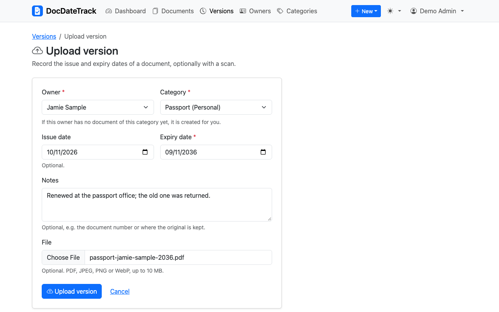
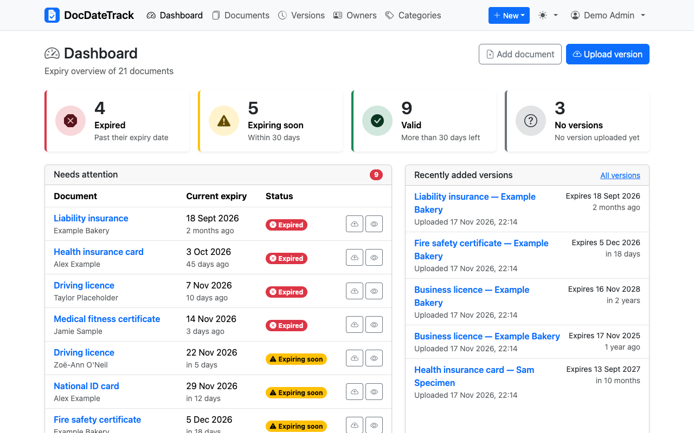
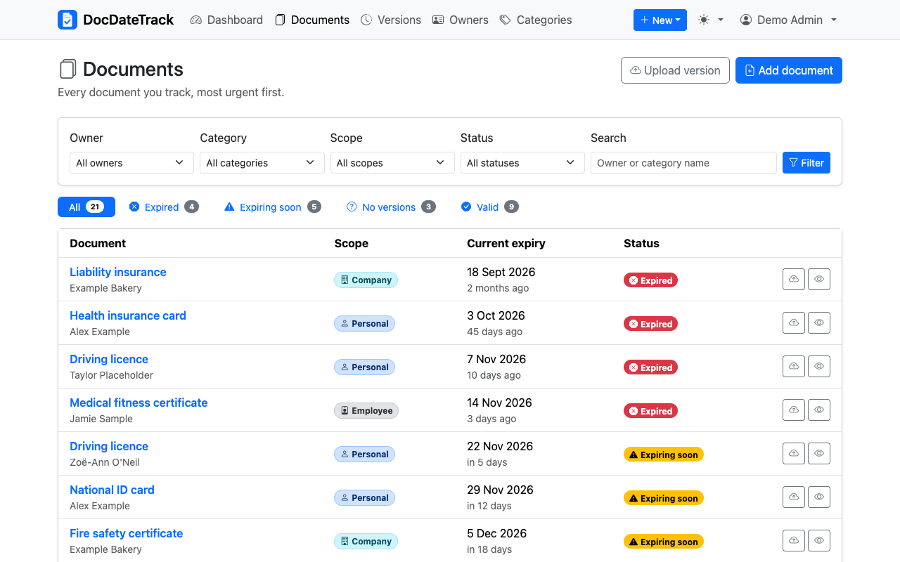
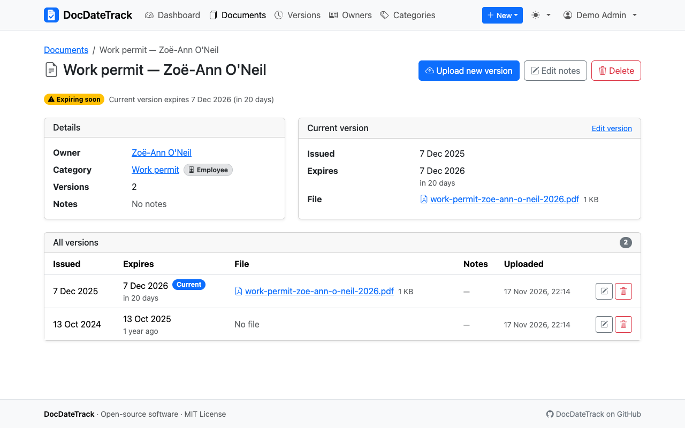
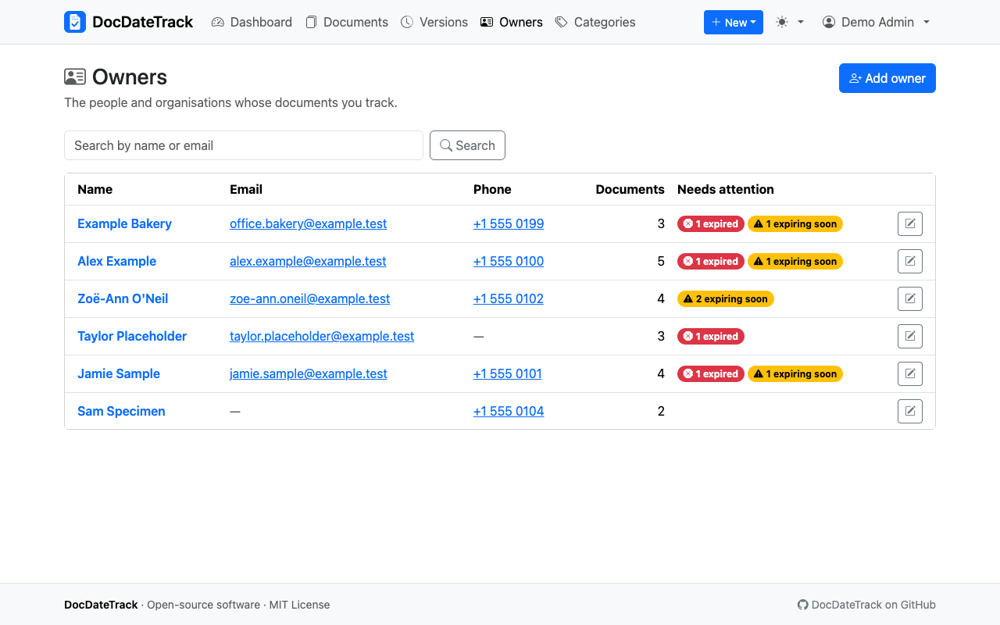
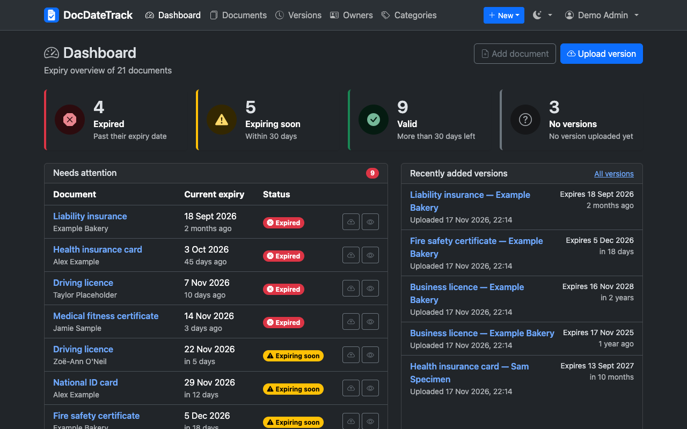

# User guide

This guide explains how to use DocDateTrack: the main concepts, your first steps, and how to work with documents, versions, reminders and user accounts. To install DocDateTrack, see the [deployment guide](deployment.md).

## Contents

- [Concepts](#concepts)
- [Signing in](#signing-in)
- [First steps](#first-steps)
- [The dashboard](#the-dashboard)
- [Finding documents](#finding-documents)
- [Working with documents](#working-with-documents)
- [Working with versions and files](#working-with-versions-and-files)
- [Owners and categories](#owners-and-categories)
- [Email reminders](#email-reminders)
- [Users and roles](#users-and-roles)
- [Your account](#your-account)
- [Light and dark mode](#light-and-dark-mode)
- [Questions and answers](#questions-and-answers)

## Concepts

DocDateTrack is built around four kinds of records:

| Record       | What it is                                                                                                                                                           | Example                                                         |
| ------------ | -------------------------------------------------------------------------------------------------------------------------------------------------------------------- | --------------------------------------------------------------- |
| **Owner**    | A person or organisation whose documents you track. Owners do not need an account.                                                                                   | Alex Example, Example Bakery                                    |
| **Category** | A type of document, with a scope: **Personal**, **Company** or **Employee**.                                                                                         | Passport (Personal), Fire safety certificate (Company)          |
| **Document** | One category of document for one owner. Each owner has at most one document per category.                                                                            | Alex Example's passport                                         |
| **Version**  | One issue of a document: its issue date, expiry date, notes and, optionally, a scan. When a document is renewed, you add a version instead of replacing the old one. | The passport issued in 2016, and the renewed one issued in 2026 |

The **scope** of a category says who its documents belong to: **Personal** for a person's own documents (a passport, a driving licence), **Company** for the documents of the organisation itself (a business licence, an insurance policy), and **Employee** for documents an organisation keeps for its staff (medical fitness certificates, work permits). Scopes help you filter documents; they do not limit who can see them.

The **current version** of a document is the version with the latest expiry date. It decides the status of the document.

### Statuses

DocDateTrack computes the status of every document from the expiry date of its current version and today's date:

| Status            | Meaning                                                                                                                         |
| ----------------- | ------------------------------------------------------------------------------------------------------------------------------- |
| **Expired**       | The expiry date has passed. A document is still valid on its expiry date and expired from the next day.                         |
| **Expiring soon** | The document expires today or within the warning period — 30 days unless your administrator changed it (`EXPIRY_WARNING_DAYS`). |
| **Valid**         | The document expires later than that.                                                                                           |
| **No versions**   | The document has no version yet, so there is no expiry date to track.                                                           |

Expired and expiring documents **need attention**. Lists show the most urgent documents first: expired ones (the longest-expired first), then those expiring soon (the soonest first), then documents without versions, then valid ones.

One DocDateTrack installation is one shared workspace: everyone who can sign in sees and manages the same owners, categories, documents and files.

## Signing in

Sign in with your **username or email address** and your password. Tick **Keep me signed in** on your own devices to stay signed in for 30 days, also after closing the browser. Without it, you are signed out when you close the browser, or after a period without activity — 12 hours unless your administrator changed it.

To sign out, open the menu with your name in the top-right corner and choose **Sign out**.

- **Forgot your password?** Ask an administrator to set a new one for you (see [Users and roles](#users-and-roles)). There is no self-service password reset by email.
- **"Too many attempts. Please wait a few minutes and try again."** After 10 failed attempts within 15 minutes, DocDateTrack refuses further attempts from your network address for a while. Your account is not locked: wait up to 15 minutes and try again.
- **No account yet?** Ask an administrator to create one. If the sign-in page shows a **Create an account** link, your administrator allows self-registration, and you can create a member account yourself.

On a new installation, the first page is the setup form: **the first account you create becomes the administrator.**

## First steps

On a new installation, the dashboard shows a **Get started** card with three steps. They take a couple of minutes.

### 1. Add an owner

Go to **Owners** and choose **Add owner** (or use **New → Add owner** in the navigation bar).

- **First name** and **last name** are required, up to 100 characters each, and may contain any characters, such as "Smith & Sons" or "Bakery 24". For an organisation, split its name over the two fields, for example "Example" and "Bakery"; owners are sorted by last name.
- **Email** is optional. If your administrator has turned on reminders for owners, this address receives reminders about the owner's documents.
- **Phone** is optional free text of up to 40 characters, so you can add an extension; **notes** are optional too.

### 2. Add a category

Go to **Categories** and choose **Add category**. Give it a unique name, such as "Passport" or "Liability insurance", choose its scope (Personal, Company or Employee) and, if you like, add a description.

### 3. Upload the first version

Choose **Upload version** on the dashboard (or **New → Upload version**):



1. Choose the **owner** and the **category**. If the owner has no document of this category yet, DocDateTrack creates it for you.
2. Enter the **expiry date**. The **issue date** is optional.
3. Add **notes** if they help, for example where the original is kept.
4. Optionally choose a **file**: a PDF, JPEG, PNG or WebP scan, up to 10 MB unless your administrator changed the limit.
5. Choose **Upload version**.

DocDateTrack opens the document's page, with its status and the new version. Repeat step 3 for every document you want to track; add more owners and categories as you need them.

You can also create a document without a version with **Add document**, for example as a reminder that someone still needs a passport. It is listed with the status **No versions** until you upload one.

## The dashboard



The dashboard is the start page. It shows:

- **Status cards** with the number of documents that are expired, expiring soon, valid and without versions. Select a card to see those documents.
- **Needs attention**: up to ten expired and expiring documents, the most urgent first. The badge shows how many documents need attention in total, and the links below the list show all expired or all expiring documents.
- **Recently added versions**: the last five versions uploaded, with their expiry dates.

## Finding documents

**Documents** lists every document with its scope, the expiry date of its current version and its status, the most urgent first.



- **Filters** — choose an owner, a category, a scope or a status; the list updates as soon as you change a filter. **Clear** removes all filters.
- **Status tabs** — the row above the list shows how many documents have each status (taking the other filters into account); select one to show only those documents.
- **Search** — type words from the owner's first or last name or from the category name and choose **Filter**. Every word must match part of a name, and the search ignores upper and lower case and accents: `zoe work` finds "Work permit — Zoë-Ann O'Neil".
- **Pages** — the list shows 50 documents per page.

Each row has two buttons: **Upload new version** and **View document**.

The **Owners** page has its own search field, which finds owners by name or email address, also ignoring upper and lower case and accents. The pages of an owner and of a category list their documents too.

## Working with documents

Select a document to open its page:



- The **status** and the expiry date of the current version are shown at the top.
- **Details** shows the owner, the category with its scope, the number of versions and the document's notes.
- **Current version** shows the dates, the file and the notes of the version with the latest expiry date.
- **All versions** lists every version, the latest expiry date first. The current version is marked **Current**.

The buttons at the top let you:

- **Upload new version** — when the document has been renewed;
- **Edit notes** — the notes of the document itself, up to 2000 characters;
- **Delete** — the document together with all its versions and their files, after a confirmation.

The owner and the category of a document cannot be changed. If you chose the wrong ones, upload the version again for the right owner and category, and delete the wrong document.

## Working with versions and files

### Renewing a document

When a document is renewed, open it and choose **Upload new version**, or use **Upload version** and choose the same owner and category. Enter the new dates and attach the new scan. The version with the latest expiry date automatically becomes the current one, and the status, the dashboard and the reminders follow it. The old version stays in the document's history.

### Dates

The expiry date is required; the issue date is optional. Both must be between the years 1900 and 2200, and the expiry date cannot be before the issue date. Dates are calendar dates: DocDateTrack does not store a time of day.

### Files

- You can attach one file per version: a **PDF, JPEG, PNG or WebP** file, up to the size limit shown under the file field (10 MB by default).
- DocDateTrack checks the content of the file, not just its name: a Word document renamed to `.pdf` is refused.
- If the form shows an error, choose the file again before you resubmit it.
- Select the file name on a document's page to download it. Files are always downloaded rather than opened in the browser, under their original name. If that name does not end in the right extension for the file's content, DocDateTrack adds it: a PDF uploaded as `invoice.html` downloads as `invoice.html.pdf`.
- Only signed-in users can download files.

### Editing and deleting versions

Use the pencil button next to a version (or **Edit version** in the **Current version** box) to change its dates or notes, to **replace the file** with a new one, or to **remove the current file**. When you replace or remove a file, DocDateTrack deletes the old file. Changing the expiry date also restarts the [reminders](#email-reminders) for that version. If someone else saved the same version while you were editing it, your changes are not saved and you see "This version was changed by someone else; reload and try again."

The bin button deletes a version together with its file. Deleting is permanent:

- deleting a **version** deletes its file;
- deleting a **document** deletes all its versions and files;
- deleting an **owner** deletes all their documents, versions and files;
- a **category** cannot be deleted while documents use it.

The **Versions** page lists all versions of all documents, the most recently uploaded first.

## Owners and categories



**Owners** lists every owner with their email address, phone number, number of documents and the documents that need attention. An owner's page shows their contact details, the number of documents per status and all their documents, with shortcuts to **Add document**, **Upload version**, **Edit** and **Delete**.

**Categories** lists every category with its scope and number of documents; the tabs at the top filter by scope. A category's page shows its documents and their statuses.

## Email reminders

If your administrator has set up email reminders, DocDateTrack checks every day (or on another schedule) which documents have expired or are expiring soon, and emails:

- **every administrator** a digest of all expired and expiring documents;
- **owners with an email address** a reminder about their own documents — only if the administrator turned on owner notifications (`NOTIFY_OWNERS`).

Each email lists the documents under **Expired** and **Expiring soon**, with their expiry dates and links to their pages, for example:

```text
Subject: [DocDateTrack] 1 document expired, 1 expiring soon

Hello Jamie Sample,

These documents need attention:

EXPIRED (1)
- Medical fitness certificate — Jamie Sample
  Expiry date: 14 Nov 2026 (3 days ago)
  https://docs.example.com/documents/…

EXPIRING SOON (1)
- Passport — Jamie Sample
  Expiry date: 12 Dec 2026 (in 25 days)
  https://docs.example.com/documents/…
```

You are reminded about a document **once when it starts expiring** (when it enters the warning period) and **once more when it has expired** — not every day. When you renew the document (upload a new version, or correct the expiry date), its reminders start over. If an email cannot be sent, it is tried again on the next run. Documents you were already reminded about are not listed again, but the email mentions how many of them still need attention.

Owners who no longer want reminders should ask for their email address to be removed from their owner record.

## Users and roles

Everyone who signs in has a user account with one of two roles:

| What you can do                                                                 | Member | Administrator |
| ------------------------------------------------------------------------------- | :----: | :-----------: |
| See the dashboard, documents, versions, owners and categories                   |   ✓    |       ✓       |
| Add, edit and delete owners, categories, documents and versions; download files |   ✓    |       ✓       |
| Change your own email address, display name and password                        |   ✓    |       ✓       |
| Receive the reminder digest, when email reminders are set up                    |        |       ✓       |
| Add, edit and delete user accounts, change roles and reset passwords            |        |       ✓       |

User accounts are separate from owners: an owner is someone whose documents are tracked, a user is someone who can sign in.

### Managing users

Administrators manage accounts on the **Users** page, which they open from the menu with their name:

- **Add user** — enter a username (3–50 characters: letters, digits, dots, hyphens and underscores), an email address, an optional display name, the role and an initial password of 10–128 characters. Share the password in a safe way; the user can change it on their account page.
- **Edit** — change the email address, display name or role, or set a new password under **Reset password**. A new password signs the user out on all their devices. Usernames cannot be changed.
- **Delete** — removes the account; the user can no longer sign in. Owners, documents and files are not affected.

Two safeguards keep DocDateTrack manageable: you cannot delete your own account, and the last administrator can neither be deleted nor made a member — make another user an administrator first. Administrators change their own password on their account page.

### Locked out?

If the only administrator has forgotten their password, or no administrator is left, someone with access to the server can use the `users` command-line task:

```bash
npm run users -- list                                  # usernames, email addresses, roles and last sign-ins
npm run users -- reset-password <username or email>    # sets a random password and prints it once
npm run users -- create-admin <username> <email>       # creates an administrator with a random password
npm run users -- promote <username or email>           # makes an existing user an administrator
```

With Docker Compose, prefix the commands with `docker compose exec app`, for example `docker compose exec app npm run users -- reset-password admin`; see [Resetting a password or adding an administrator](deployment.md#resetting-a-password-or-adding-an-administrator). A password reset signs the user out everywhere. Sign in with the printed password and change it on your account page right away.

## Your account

Open **Account** from the menu with your name to:

- change your **email address**, which you can also use to sign in, and your **display name**, which is shown instead of your username;
- **change your password**: enter your current password and the new one (10–128 characters) twice. Changing your password signs you out on all your other devices;
- see your **role**, your **last sign-in** and since when you have an account.

Your username cannot be changed.

## Light and dark mode

Use the theme menu in the navigation bar (its icon is a sun, a moon or a half-filled circle) to switch between **Light**, **Dark** and **Auto**, which follows the setting of your device. Your browser remembers the choice; the sign-in page has the same menu.



## Questions and answers

**I uploaded a new version, but the status did not change.** The status follows the version with the latest expiry date. If the new version expires earlier than an existing one — for example because you added an old version for the record — the existing version stays current. Check the dates under **All versions**.

**A document shows as expired one day later or earlier than I expected.** "Today" is the date in the server's time zone. Ask your administrator to check the `TZ` setting.

**Why was my file refused?** Only PDF, JPEG, PNG and WebP files are accepted, up to the size limit shown under the file field. Convert other formats first, for example by saving or printing them as PDF.

**Can I limit who sees which documents?** No. Every signed-in user can see and manage all records; only user management is reserved for administrators. Give accounts only to people who should see all documents.

**Where are my files stored?** On the server that runs DocDateTrack, in its upload directory, under random names. Your administrator should back them up together with the database.
